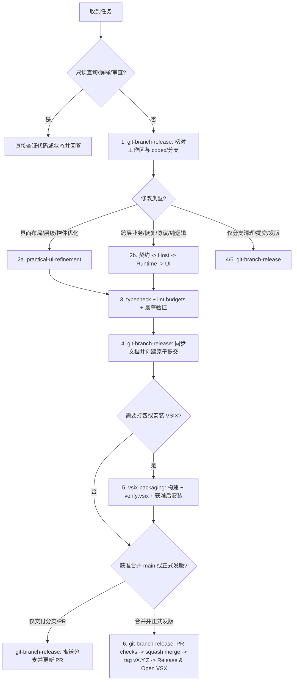

# Droid 项目开发与交付流水线（统领入口）

## 用途与触发

- **用途**：为 `droid-for-vscode` 的日常功能开发、界面样式整改、Bug 修复、本地试用打包安装以及 PR 合并与正式版本发布提供统一入口、固定阶段顺序和子 Skill 路由。
- **何时使用**：用户提出涉及本仓库代码修改、界面优化、构建打包、编辑器安装、分支整理、提交推送、PR 合并或版本发布的任务时，先从本入口确定阶段路径，再按需进入对应子 Skill 正文执行。
- **何时不使用**：纯解释、代码审查、状态查询或远端数据查询默认只读，直接查证并回答，不进入写文件、构建或提交流程。

## 执行清单（按顺序）

根据当前任务授权的范围勾选推进（未获授权的后置阶段不自动越界执行）：

```text
- [ ] 1. 工作区与分支基线 → `git-branch-release`（步骤 1）：核对 git status / worktree / origin/main 差异，保护未跟踪文件（如 .vscode/）与无关草稿，在 codex/<task> 分支工作
- [ ] 2. 任务路由与实现：
      - 2a. 界面布局、信息层级、选择器、工具栏、弹层或共享组件整改 → `practical-ui-refinement`
      - 2b. 跨层业务、恢复、协议或编辑器交互实现 → 按「共享契约 → Host → Runtime → Webview」顺序接通
- [ ] 3. 验证收口：运行 typecheck、lint:budgets 及受影响的最窄定向测试或真实 Browser Dev Client 验证（用户声明“我来验证”时立即停止追加页面与回归检查）
- [ ] 4. 文档同步与原子提交 → `git-branch-release`（步骤 2）：按需更新 docs/STATUS.md、DESIGN.md、PLAN.md，精准暂存本任务路径并创建 Conventional Commit 原子提交
- [ ] 5. VSIX 打包与本地安装（按需）→ `vsix-packaging`：串行执行 package:vsix 与 verify:vsix；仅在获本次明确安装授权后核对 VS Code / Cursor CLI 安装并提示 Reload Window
- [ ] 6. PR 合并与正式发版（需明确授权）→ `git-branch-release`（步骤 3–5）：推送分支、等待 PR checks 通过、squash 合入 main、打 v<version> 标签、复用同一已校验 VSIX 公开 GitHub Release 与 Open VSX、清理已合入分支
```

## 核心铁律

1. **工作区与在途工作保护**：开始前先查 `git status --short --branch` 与 `git worktree list`。保留 `.vscode/`、其他任务分支及 `codex/wip-*` worktree，禁止自动 `stash`、`reset --hard`、`clean` 或在脏工作区使用 `git add -A`。
2. **公共 UI 与分层职责边界**：所有生产 Webview（Chat、Models、Mission、Viewer、Review）统一使用 `packages/chat-ui/src/ui/` 与 `ai-elements/`，禁止业务层直接写原生 `select`、`button`、可见 `input/textarea`、`details/summary` 或用左侧装饰竖线代替信息层级。`packages/chat-ui` 不得反向引用 Runtime、Host、Bridge 或 VS Code API；所有界面提示、占位与状态文案须带 `data-ui-notice=""` 排除出复制结果。
3. **短交付与“我来验证”即停**：小样式、间距、高度、占位文字和简单局部交互只做一次针对性检查后收口。当用户明确表示“我来验证”或“停止验收”时，立即停止追加浏览器与回归测试，完成静态检查、一次打包校验与原子提交后直接交付。
4. **CI 环境对齐与单次串行构建**：Windows / PowerShell 下每次 `Execute` 都是独立进程，必须在同一条命令内切入与 CI 一致的 Node 24 与 `pnpm@10.2.0`、进入仓库根目录并串行执行。`package:vsix` 已包含 `typecheck → lint:budgets → build:chat-ui → build`，禁止手动先跑整套构建再重复打包，也禁止并行写入 `dist/`。
5. **构建、安装、合并与发版授权分离**：生成并校验本地试用 VSIX 不代表获准安装到编辑器；获准本地安装不代表获准合并 `main`；获准合并 `main` 不代表公开发布 Release。每项外部生效动作只按当次明确授权执行，不沿用历史授权。
6. **正式版单产物一致性**：正式发布必须从已通过 `PR checks` 并 squash 合入 `main` 的干净提交及对应 `v<version>` 标签构建。GitHub Release、Open VSX 与本地 VS Code / Cursor 安装必须复用**同一份已校验 VSIX 与 SHA256**，禁止逐渠道重编、移动已发布标签或覆盖同版本产物。
7. **文档快照维护**：文档入口为 `docs/README.md`。`docs/STATUS.md` 只写当前版本与验证缺口，`docs/PLAN.md` 只留待办，`docs/DESIGN.md` 只留有效设计约定；原地更新对应小节，不新建临时调研、交接或验收 Markdown。

## 流程总览



## 阶段与子 Skill 索引

| 阶段 / 场景 | 子 Skill | 入口路径与参考资料 | 核心职责 |
| --- | --- | --- | --- |
| **界面与样式整改** | `practical-ui-refinement` | [SKILL.md](../practical-ui-refinement/SKILL.md) · [模型选择器案例](../practical-ui-refinement/references/droid-model-picker.md) | 从真实页面问题出发收紧布局与信息层级，复用 `packages/chat-ui` 组件，保护已有值变更与键盘/IME 语义 |
| **VSIX 构建、校验与本地安装** | `vsix-packaging` | [SKILL.md](../vsix-packaging/SKILL.md) · [故障处理参考](../vsix-packaging/references/troubleshooting.md) | 对齐 Node 24 / pnpm 10.2.0 环境，使用排除 `.vscode/**` 的临时 ignore 文件一次串行打包并通过 `verify:vsix`，区分 VS Code 与 Cursor CLI 安装 |
| **分支管理、原子提交、PR 合并与正式发版** | `git-branch-release` | [SKILL.md](../git-branch-release/SKILL.md) · [发版与分支清理清单](../git-branch-release/references/release-checklist.md) | 维护 `codex/<task>` 分支与 worktree 卫生，执行精准暂存与原子提交，推进 PR CI、squash 合并、版本标签构建、GitHub Release / Open VSX 单产物发布及无用分支清理 |

## 跨层代码定位速查

| 层级 | 目录 | 职责与修改原则 |
| --- | --- | --- |
| **公共 UI 包** | `packages/chat-ui/src/{ui,chat,review,ai-elements,styles}/` | 纯展示与通用交互原语；通过 props、回调与插槽接入，不引用 Host / Runtime / VS Code API |
| **共享契约** | `src/shared/protocol/`、`src/shared/bridgeMessages.ts` | Webview 与 Host 之间的消息类型与信任边界输入校验；跨层修改先稳定契约 |
| **Webview 业务适配** | `src/webview-v2/{chat,models,mission,review,viewer,state}/` | Droid 页面状态、Store reducer、Bridge 消息收发与组件装配 |
| **Extension Host** | `src/extension/{chat,review,management,autocomplete,changes,recovery}/` | 会话调度、文件读写、Git 快照、权限确认、编辑器命令与本地持久化 |
| **Runtime 适配** | `src/runtime/` | Factory Droid CLI / SDK 进程与 daemon 通信适配；不引用 VS Code 或 React |
