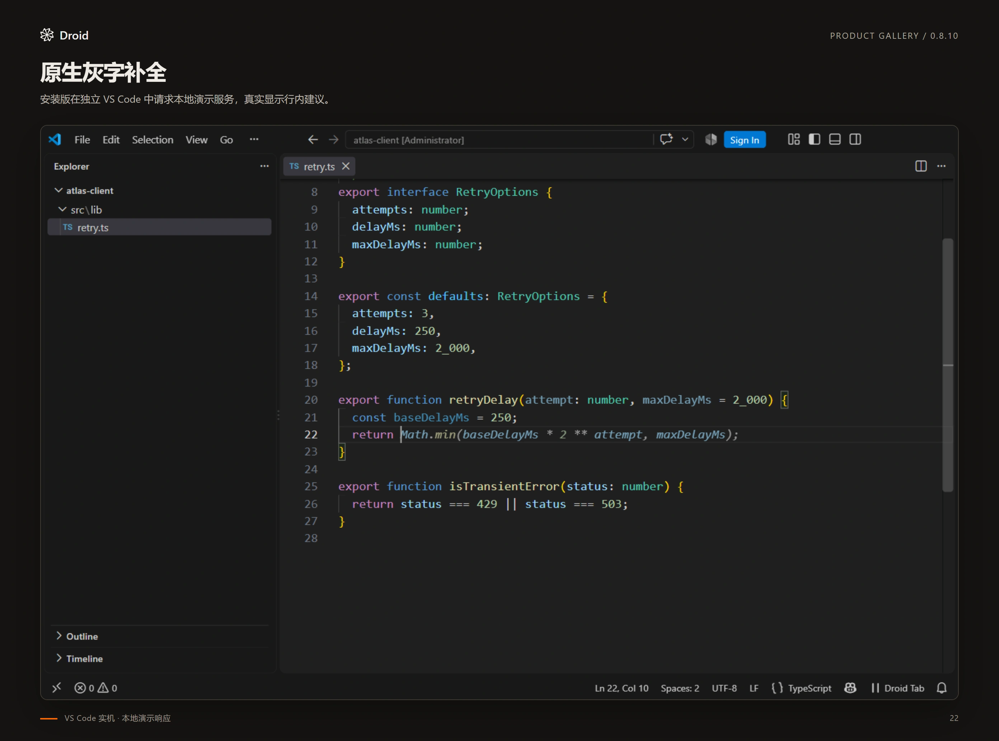

# 代码补全与 Next Edit

[返回项目首页](../README.md) · [全部文档](README.md)

代码补全与 Next Edit 随 Droid 安装包提供，默认关闭，使用独立模型服务，无需先打开聊天。

## 配置与使用

1. 命令面板运行 **Droid: Configure Autocomplete**，选择服务，再填写完整地址、
   模型和密钥。提供 Mistral/Codestral、DeepSeek、SiliconFlow、Ollama、自定义 FIM，以及 Inception/Mercury FIM 和 Next Edit 预设。
   Ollama 默认地址是 `http://localhost:11434/api/generate`，模型为
   `qwen2.5-coder:7b-base`，需要先自行安装该模型；本地服务可以不填密钥。
2. 配置完成后选择 **Enable autocomplete**。稍作停顿显示灰字，**Tab** 接受、
   **Esc** 关闭；**Droid: Request Code Completion** 可手动请求或重试。
   语言服务候选列表打开时，AI 可继续补全选中项之后的代码。
3. 状态栏 **Droid Tab** 提供启停、自动/仅手动请求、暂停 5/15/60 分钟、立即恢复、
   服务配置、相关文件开关、设置和删除已存密钥；停用后仍可点击状态栏恢复。错误显示在状态栏，自动请求
   对 429/网络/服务错误指数退避，连续失败后暂停 5 分钟；认证/余额错误等待手动重试或重新配置。

<figure class="droid-screenshot">

[](images/v0.8.10/final/22-inline-completion.webp)

<figcaption>建议显示在光标处，按 Tab 接受。截图来自安装 v0.8.10 的 VS Code，使用本地演示响应。点击查看原图。</figcaption>
</figure>

## 上下文与数据读取

普通续写接入 Kilo/Continue 的导入定义、语法路径、近期编辑/浏览/打开文件、排序与
token 裁剪。语法分析资源随包提供，定义查询使用已有语言服务。总请求默认限制为
12,000 个 UTF-16 文本单位，含标头，至少 60% 可用预算留给主文件；优先使用未保存内容。
相关文件可以关闭；无对应语法或语言服务时仍可用当前文件与允许的近期片段。
Codestral 使用多文件模板，其他服务使用语言注释承载关联片段；Mercury FIM 保留关联
片段，修正上游模板丢弃片段后猜错跨文件参数的问题。文件变化会撤回旧请求与旧建议。

Notebook 代码单元使用相邻同语言单元构造上下文，并映射回当前单元接受和撤销；
单元内容或顺序变化会使缓存失效。官方 Mercury Next Edit 模式下，Notebook 自动走
Mercury FIM；普通文件保持当前选定模式，Next Edit 空结果不会自动再请求 FIM。

密钥只保存到编辑器 SecretStorage，并绑定完整 endpoint；官方 Mercury 的 FIM/Edit 两个地址共用凭据。
模型和地址只取用户级配置。
跨文件读取遵循 `.gitignore`、`.droidignore` 和 `droidvisx.autocomplete.excludePatterns`，
跳过已识别的敏感/生成/二进制文件及工作区外链接，不读取聊天历史。默认不枚举项目文件、
不读取剪贴板；`staticContext` 开启后为 TypeScript 枚举至多 2,000 个候选，仍遵循读取规则。
`includeClipboard` 仅接受用户级显式开启，最多读取 4,000 字符；相关文件和剪贴板开关独立。
设置集中在 `droidvisx.autocomplete`。模型服务独立计费或由本地运行，不使用 Factory
订阅或聊天 Session；普通聊天接口不能直接当作 FIM 接口。

## 模型服务与协议

支持原生 FIM 的 Mistral/DeepSeek 兼容接口、Ollama `/api/generate`，以及硅基流动的 FIM 扩展。
SiliconFlow 预设使用 `Qwen/Qwen3-Coder-30B-A3B-Instruct`，协议选 `siliconflow-fim`，
地址为 `https://api.siliconflow.cn/v1/chat/completions`；按[官方 FIM 文档](https://docs.siliconflow.cn/docs/userguide/guides/fim)
发送 `prefix/suffix`，使用该平台 API key，不走聊天 Session。
选择模型时需确认其支持代码续写/FIM；Ollama 指令模型的模板可能在 EOF 空后文时进入
聊天，默认选择 base 模型避免此问题。建议质量和延迟仍取决于实际服务及模型。
使用 Cursor Tab 或其他灰字补全时可选择启用一种；状态栏提示可能的竞争来源，不替用户关闭其他补全器。

## Next Edit 编辑预测

选择 **Inception / Mercury Next Edit**，默认模型 `mercury-edit-2`，地址
`https://api.inceptionlabs.ai/v1/edit/completions`，使用 Inception API key。
该模式与 **Inception / Mercury FIM**（`/v1/fim/completions`）可从状态栏切换，
官方两个地址复用 Inception key。其他服务仍按完整地址隔离凭据。

- 同行可续写的内容显示原生灰字；已有代码替换、删除和跨行修改显示主题化修改提示。
- 修改位于别处时，第一次 **Tab** 跳转，第二次接受；光标已在修改处时直接接受。
  **Esc** 丢弃，接受后可 **Undo**。Tab 接管仅在存在待接受修改且没有选区、候选列表或 snippet 时生效。
- 预测使用光标附近可编辑区域、最多 5 段近期编辑历史和允许的相关文件。
  开启相关文件后，Next Edit 与普通续写共用导入／语法路径定义检索；依赖文件无需先打开。
  定义与近期浏览片段并行收集，定义优先占用参考预算；语言服务超时保留已取得的内容，
  关闭相关文件或被忽略的依赖不会进入请求。
  请求前收集所有已修改文件尚在等待防抖的历史，按实际编辑顺序排列，避免快速跨文件修改时漏掉依赖变化。
  已支持的语法在 25 行上限内补齐被窗口切开的短声明，避免将区域外的结束括号再次插入；
  大声明、未完成语法及未支持语言保留原窗口，区域外代码仍作为只读上下文。
  文件被编辑、切换、权限/配置变化后旧建议失效；不完整或截断的回复不会应用。
- 请求、缓存、退格复用、防抖和编辑提示部分移植自
  [Kilo Code](https://github.com/Kilo-Org/kilocode/tree/7d977bce994af36f0edf752cb53e3aefc7aeb214)，
  Kilo MIT、Continue Apache-2.0 及语法包/分词器许可随包分发；Host 生命周期、读取边界和服务适配由 Droid 负责。
- `adaptiveDebounce` 开启时，普通续写和 Next Edit 在首次输入或至少 1 秒空闲后立即开始准备；
  连续输入时，普通续写初始等待 150ms，积累响应后在 150–250ms 间调整，Next Edit 等待 250ms。
  关闭自适应后仍使用设置的 `debounceMs`，手动触发不等待防抖。
  普通续写在防抖期间并行准备上下文，两者均完成后才发送，不把检索耗时再叠加到整段等待之后。
  兼容的连续输入共享正在等待、收集上下文或生成的任务，不重启计时或重复收集；过期调用不显示结果，
  最后一个消费者离开后通常保留 100ms 交接时间。若仅编辑器取消调用、文档与光标未变且请求已发出，
  为替代调用保留 250ms，接上后恢复普通时限；取消的调用仍立即返回，配置、Notebook 或外部上下文
  变化仍撤销旧任务，不为全部取消统一延长等待。
  `if`、`for`、较长标识符和条件右括号后的停顿可以触发，不再按单词长度或结束字符直接禁止请求。
- 建议历史最多 20 条，正结果保留 30 秒，空或过滤结果只保留 1 秒；手动请求可立即绕过负缓存。
  支持继续输入和退格复用，已完全输入的建议允许继续请求下一段。行中续写只展示首行，
  完整结果留在缓存。普通正文编辑保留 ignore 规则缓存；规则修改和完整重置仍使其失效。
- 相关文件优先保留导入定义及当前函数签名使用的类型，再使用近期文件；当前缓冲区已有内容不重复占用参考预算。
  类型依赖会沿当前文件已解析的导入继续展开，不增加额外语言服务请求。查找超时保留已取得的定义，
  下次仅重试未完成的绑定；重命名导入只查询本地绑定一次，避免重复消耗查找时间。
- Mercury FIM 在刚打开 `{` 的空白行、后文紧邻独立 `}` 时，为请求后文补充分行边界，
  并在返回内容与原有闭合行之间保留换行，避免服务提前截掉内层闭合括号。
  行中续写、已有换行及其他模型保持原请求；不根据测试答案补写语句或括号。

## 效果与输出限制

验证记录见 [STATUS](STATUS.md)。真实模型小样本通过率不等于日常代码接受率，
也没有与 Kilo 做同模型、同输入的产品胜率对比。

代码文档中的模型结果若包含独立的反引号围栏行，扩展会隐藏整条建议并在状态栏提示，
不会自动拆包或截掉那一行。相同上下文短暂缓存拒绝结果，避免自动重复请求；通过状态栏的
**Request suggestion / retry** 可重新请求。Markdown、MDX、纯文本允许围栏；代码里的
内联围栏文字保持原样。缺少语法证据时，包含独立围栏的合法多行字符串/注释补全也可能
被抑制。这只处理可疑格式，不能证明生成代码的语法和语义正确。

重复过滤保留确切重复与循环输出保护，不再仅因两行变量名或字面值相近而拒绝整段代码。
多行建议首尾与相邻代码相同的闭合括号可属于不同嵌套层级，不再因此丢弃整个 `if`、循环或调用。
本地日志区分编辑器触发、跳过、共享任务、真实模型请求、空结果和格式/重复过滤；接受事件包含
建议编号，可关联到返回项。结果耗时包含本次调用的等待、策略检查、上下文与请求阶段，另记录
上下文和网络耗时；“返回候选”不代表编辑器确实展示，也不能直接计算真实曝光接受率。

请求生命周期与诊断本次对照了 [Kilo `d21e197`](https://github.com/Kilo-Org/kilocode/tree/d21e1974a71ccb8895af69076035c966389b490f/packages/kilo-vscode/src/services/autocomplete)：
借鉴待办任务共享、生成结果独立缓存和建议关联，保留 Droid 的取消与文件读取边界。
上游同样存在词长跳过和完整响应后展示的策略，未整体照搬；当前仍等待完整 FIM 响应，
没有宣称具备 Cursor 自有 Tab 模型的延迟或命中率。

## 自动质量评估（开发用途）

真实模型评估由独立题库提供前文、后文、参考文件和隐藏行为测试；题库作者的参考答案与测试
不发送给补全模型。临时开发 Host 使用 VS Code 正常配置及 SecretStorage 调用 FIM 服务，
无需用户重载窗口、启动 Browser Dev Client 或提供连接；密钥不导出、不复制到测试配置。

```sh
node src/integration/withAutocompleteGateway.mjs "<Microsoft VS Code/Code.exe>" -- node src/integration/generateAutocompleteQuality.mjs --corpus <题库.json> --output <结果.json>
```

运行期间打开一个临时开发窗口，命令结束后自动关闭；原窗口不重载。运行器编译当前网关源码，
使用临时连接描述文件传给子进程，结束后移除该文件。结果记录首次响应、过滤与耗时；生成步骤
会调用真实模型服务。也可继续用 `DROID_AUTOCOMPLETE_BRIDGE_URL` 接入已有 Browser Dev Host。

题库支持 TypeScript、Python 3.11 与 Go 1.23+。审阅生成程序后，运行下列命令检查源码并执行行为断言：

```sh
node src/integration/runAutocompleteQuality.mjs --corpus <题库.json> --responses <结果.json> --output <报告目录> --reviewed
```

使用 `--reference` 替代
`--responses` 可先校验独立作者的参考答案，不能将这类通过计入模型分数。运行器需要 Node 26+；
TypeScript 使用 strict 类型检查，执行进程只允许读取本题目录与运行器，禁用网络、写入和子进程。
Python 使用语法检查与独立进程中的行为测试，不做静态类型检查；可设置 `DROID_AUTOCOMPLETE_PYTHON`
为 Python 3.11+ 可执行文件，默认使用 `python`。Python 固定 UTF-8，忽略用户环境与 site 配置，
禁写字节码；审计钩子限制文件、网络和子进程操作，允许标准 asyncio 初始化内部唤醒通道。
两种执行均限制时间与输出，逐个隐藏测试重置题目模块；Python 没有 Node 的堆内存上限。
这些限制不能代替对未知程序的审阅，也不宣称是恶意代码安全沙箱。

Go 使用真实编译器检查本地模块及跨包引用，再为每条隐藏测试启动独立测试进程。
入口属于根目录的 `completion` 包，本地模块名为 `example.invalid/autocomplete-eval`；
`references` 可包含本地子包，`testImports` 声明隐藏测试使用的标准库，默认导入 `testing` 和 `fmt`。
测试需调用 `check(condition, message)`，没有断言、编译失败、运行失败或超时均不能通过；
构建关闭模块下载、工具链下载和 cgo，仅使用标准库及题目文件。可通过 `DROID_AUTOCOMPLETE_GO`
和 `DROID_AUTOCOMPLETE_GOFMT` 指定工具路径。Go 执行限制时间与输出，设置 128 MiB 软内存目标，
没有 Node 的文件／网络权限隔离，必须先审阅候选程序；这也不是恶意代码沙箱。

首次局部续写和整个函数完成应分别统计；不能将尚未补完的函数全部标成语义错误。
题库导入脚本 `src/integration/autocomplete-quality/importDroidCorpus.mjs` 接受 Droid JSON 响应与目标路径，
保留作者会话和原始响应哈希；原始响应、参考实现验证与模型作答分开保存。

该入口的多文件内容由题库明确提供，单独评估提示构造与模型使用上下文的能力，不代表 LSP
检索或编辑器灰字已验证。真实输入、接受、取消、Notebook 和检索走已有
`src/integration/runAutocompleteTest.mjs` 的隔离 Extension Host 命令测试，无需鼠标自动化。

真实模型的原生编辑器评估可给该运行器加 `--quality`，并设置
`DROID_AUTOCOMPLETE_QUALITY_CORPUS` 和 `DROID_AUTOCOMPLETE_QUALITY_OUTPUT`。
运行器加载指定的新 VSIX 到临时用户目录，在隐藏测试桌面通过 VS Code 命令输入、触发和接受建议，
TypeScript 使用内置语言服务寻找参考文件；Python、Go 将题目参考文件打开后使用生产上下文检索，
隔离配置没有这两种语言的语言服务，报告明确记录此差异。Go 在编辑器中用 `gofmt` 只解析、不执行源码，
完整编译与隐藏行为判分在后续步骤进行。每题最多接受 12 次，源码结构完成后只接受已缓存的后续
内容，不再调用模型，缓存耗尽或无建议后停止。停止条件不读取隐藏测试，不能证明函数已实现全部需求。
临时测试配置关闭自动补括号、引号与缩进，并逐字核对原生输入后的前后文，避免编辑器改变题目。
FIM 题目间排除其他题目目录；请求发送前与判分时均核对提示中的参考文件，只允许本题入口和依赖。
报告标记 `native-context-case-isolated`，并记录各请求的参考路径；旧 `native-context` 报告未做这项隔离，
可能包含前题近期文件，应标记为混合上下文观测，不能当作独立题成绩或与隔离结果直接归因比较。
报告记录 VSIX 哈希、自动请求、每次原始返回、接受轨迹与最终源码，再用上述运行器判分。
默认轨迹只接受建议。设置 `DROID_AUTOCOMPLETE_QUALITY_TYPING=newline-after-empty` 可单独评估
回车续写：源文件尚未完成且服务返回空内容时，每题最多通过编辑器输入一次换行，再观察自动请求。
`userEdits` 记录实际插入、位置与自动触发，接受记录另存距该次输入的耗时；这类结果与默认轨迹分别报告，
换行不能计为模型生成字符，也不根据隐藏测试选择输入或增加重试。

设置 `DROID_AUTOCOMPLETE_QUALITY_TYPING=continuous-input` 可对同一独立作者题库重放逐字输入、
停顿后继续及输入错误字符后退格三种轨迹；每个原生操作后核对正文，最终前后文必须与原题完全一致。
报告记录 `typingVariant`、`inputEvents`、最后一次输入时间、请求取消及接受结果。既有行首闭合符
留在初始文件中，避免编辑器自动缩进改写题目。该模式改变输入轨迹，不新增考题或修改隐藏断言，
必须与默认停顿轨迹分别报告；首次接受耗时从最后一次键入完成后开始计算。

已有代码的 Next Edit 轨迹使用 `--next-edit-quality`，仍通过上面的临时网关启动，不需要重载用户窗口。
题库设置 `mode: 'next-edit'`，每题提供 `entryFile`、`initialFiles: [{ path, content }]` 和
`edits: [{ path, before, after }]`；编辑按顺序通过真实 `type` 命令执行，最后一项必须属于入口文件，
替换内容末尾即为光标。当前原生轨迹支持 TypeScript，参考文件的改动保留在真实编辑器缓冲区中。
`before` 必须唯一匹配。作者答案与隐藏测试留在题库中，测试工作区只写入初始源码。
每题最多调用模型 3 次，记录自动触发、跳转、逐次接受和最终源码；到达上限的本地拒绝单独标记，
不能计作模型失败。题目间通过临时配置排除其他题目目录，并检查实际提示中的文件来源，
防止生产“最近查看文件”机制将前题代码带入后题。用户配置保持不变。
报告中的 `source` 是完整源码，后续用原题最终参考文件和隐藏行为测试判分，不能当作 FIM 插入片段。
题目可用 `closedFiles` 列出仅写入磁盘、不在编辑器中打开的依赖；请求仍由生产代码收集上下文，
不会把这些依赖直接注入提示。评分使用相同磁盘文件，报告同时保留关闭文件列表与实际请求。
连续接受可能引入后续错误，应同时审阅逐次 `accepts` 与最终源码，不能挑选最好的一次作为最终得分。

原生 Next Edit 结果使用独立判分命令：

```powershell
node src/integration/gradeNextEditQuality.mjs <corpus.json> --reference <oracle-output>
node src/integration/gradeNextEditQuality.mjs <corpus.json> <responses.json> <score-output>
```

题目可声明 `expectedChange: false`，表示用户编辑已经完成；参考答案必须与编辑后的输入逐字一致。
这类题同时检查隐藏行为和是否产生多余接受，语义等价的无必要改写单独标记。正题声明
`expectedChange: true` 时，参考校准还确认编辑后的未补全代码确实不能通过全部断言。
判分核对题库哈希、真实输入、依赖及最终接受；使用生产解析器检查响应，服务失败、截断或格式错误
不能因保留了正确原代码就计为成功。逐次接受的语义成绩保留，最终得分始终使用最后状态。
测试断言中的 `const mod = require(entry);` 仅适配为评分进程提供的 `subject`，不改写断言。

仅在提示格式对照实验中，可设置 `DROID_NEXT_EDIT_PROMPT_VARIANT=without-sentinel`，从实际请求末尾
移除旧结尾标记。报告记录 `promptVariant` 和原始 `providerPrompt`；这种请求经过实验修改，
不得作为未改动生产请求的证据。默认 `production` 逐字转发，不改变用户设置。

临时模型网关还支持 `{ kind: 'next-edit', context }`，其中 `context` 使用生产
`MercuryEditContext` 结构（当前文件、光标、可编辑区域、参考片段与编辑历史）。仅当前配置为官方
Mercury 服务时提供此能力，固定使用同一模型及配对的官方 Edit API，不更改用户配置，不接受外部
指定的地址或模型。返回的是生产解析器接受的整个区域替换；判分时将其应用到原区域，再用原题测试
检查完整源码。直接提供参考文件的结果标记为 `supplied-fixtures`，不能当成原生编辑器或 LSP 验证。
Next Edit 沿用生产最少 512 token 的请求预算，与默认 256 token FIM 的单次成本及延迟不能直接等同。
诊断时可使用 `kind: 'next-edit-inspect'`，记录原始模型文本、结束原因和输出 token 数；此入口允许
32–1024 的 `maxTokens` 对照（沿用生产至少 512 的规则），仍固定当前模型及官方配对地址。
只有 `stop` 且生产解析器接受的文本才附带 `replacement`，截断或格式错误不能当成可应用建议。
普通 `next-edit` 入口不接受预算覆盖，诊断不会改变用户设置。
`raw-fim` 返回 `streamTiming`，记录响应头、首字节、首个非空白文本、首条完整非空白行和完整响应的
到达时间，以及网络块和文本事件数量。观测仍经生产解析器验证，不改变生成参数或返回代码；
JSON 响应单独标记，缺少完整行时不填该项。首条完整行只是计时点，不代表语法完整或可直接展示。
原生运行器使用 `raw-next-edit` 转发打包后 Provider 构造的完整请求，不重建提示；网关固定当前
Mercury 模型、官方配对地址和生产 token 预算，原始正文及结束原因交回打包后的生产解析器处理。
审阅题库后再运行；该模式会调用真实模型，并不执行模型代码，代码行为仍在后续受限进程中测试。

将同一网关命令的子命令替换为 `node src/integration/runAutocompleteTest.mjs <Code.exe> <VSIX> --quality`
即可验证新包。新 VSIX 的上下文、请求体、过滤与编辑器行为均来自隔离测试进程；网关只转发
已配置的服务及模型，避免旧 Host 重建请求而掩盖新代码变化。普通批量生成也使用当前后处理源码。
可用子命令 `node src/integration/autocomplete-quality/gatewayCheck.cjs` 检查真实 Host 的访问与请求边界，
此检查不调用模型。以上方式依赖本机已有 VS Code 配置与可用模型凭据，不依赖旧浏览器连接。
