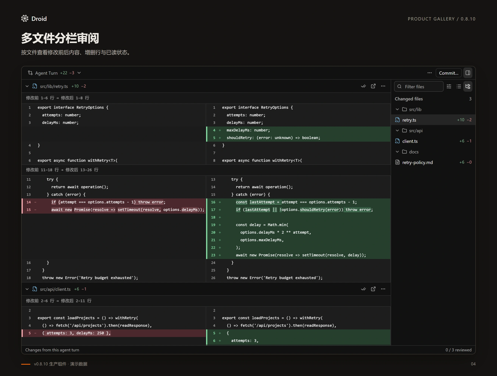
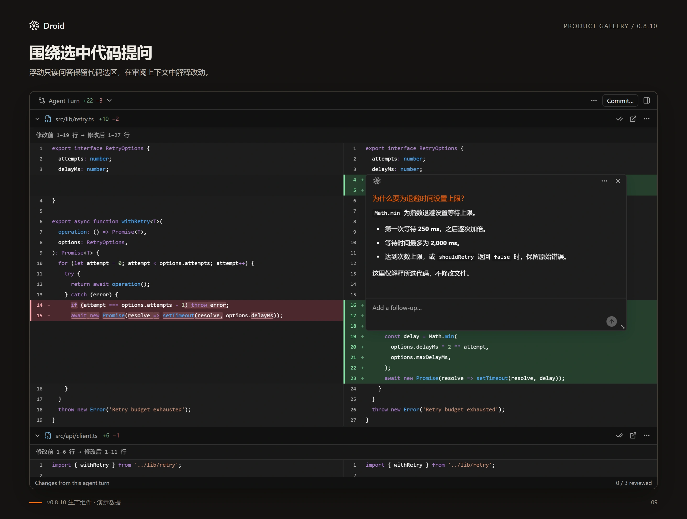

# 审阅文件改动

Review 用来查看一次编辑、整轮任务或 Git 中的文件变化。新增与删除位置使用
`+` / `−` 和颜色标记，短修改行会进一步强调发生变化的词。

单次编辑默认显示工具实际记录的改动片段；整轮与 Git 比较默认保留 3 行上下文。
需要核对周围代码时，可以扩大上下文或打开完整版本比较。

## 打开 Review

从聊天汇总卡点击 **Review**，查看本轮 Agent Turn；点击文件行直接定位该文件。
也可以运行 **Droid: Review Changes**，集中浏览变更文件。

聊天底部的 **Review** 同样打开 Agent Turn；Recorded Edits 可在范围菜单中选择。
单次工具卡片中的 **Review** 则定位原工具、文件和该次编辑。
同一个文件的历史编辑与当前工作区内容可能不同，先确认顶部范围。

<figure class="droid-screenshot">

<figcaption>按文件对照修改前后的代码，并跟踪审阅进度。v0.8.10 界面示例，使用演示数据。点击查看原图。</figcaption>
</figure>

## 选择比较范围

| 范围 | 比较内容 |
| --- | --- |
| Recorded edits | 本轮工具记录的逐次编辑；History 可切换同一文件的不同编辑 |
| Agent Turn | SDK 确认修改的文件；比较本轮开始与结束版本，运行中显示当前版本 |
| Workspace | HEAD 与当前工作区，包含未跟踪文件 |
| Branch | 所选基准分支与当前 HEAD 的共同祖先 → 当前 HEAD |
| Unstaged | Index 与当前工作区，包含未跟踪文件 |
| Staged | HEAD 与 Index 中已经暂存的内容 |

Git 比较使用本机 Git，不依赖聊天是否连接。还没有首次提交的仓库可以查看 Workspace、
Staged 和 Unstaged；Branch 需要已有提交。基准分支来自本地已有引用，不会自动 fetch。
没有唯一的远端默认分支引用时，需要在选择器中明确指定。

同一文件既有暂存修改又有未暂存修改时，可以分别检查 Staged 和 Unstaged。
Agent Turn 的文件名单与聊天汇总使用同一套成功操作证据，工作区监听不会额外加入文件。
文件前后版本仍可能包含同文件的手工修改，快照净行数也不等于聊天中的累计操作行数。
Agent Turn 的增删统计与文本 Diff 忽略 LF / CRLF 行尾格式差异，仍保留缩进及文件末尾
换行的变化；原始快照正文不被转换。重开历史 Review 时从保存的快照重新统计，避免沿用旧数字。
只有命令副作用、没有 SDK 逐文件成功记录的文件，不会列入 Agent Turn；当前变化可在
Uncommitted 等 Git 范围查看。

## 阅读与切换视图

- 在文件列表中选择目标文件，或使用筛选框缩小范围。
- 顶部可直接切换合并／分栏视图，分别在一列查看增删或左右对照两份内容。
- 顶部上一处／下一处按钮直接跳转修改，避免在大文件中反复寻找改动。
- 上一文件／下一文件遵循当前筛选；切换文件、编辑与视图时保留对应阅读位置。
- 整轮和 Git 比较可选择 3、20、100 行上下文或 **Full file**。
- 同一文件多次编辑时，从 History 选择目标；新结果到达不会把正在读的旧编辑切走。
- 完成检查后使用 **Mark viewed** 标记已读。Recorded edits 中的标记覆盖该文件当前版本的全部记录。

**Mark viewed & next** 等待已读状态确认后再跳转。加载中、发生变化或预览被截断时，
不会把未完整检查的内容标为已读。刷新期间保留旧对比，读取成功后才替换。

已读标记只记录审阅进度，不等于代码正确，也不会自动提交改动。
提交前仍需检查范围和实际结果。

## 就选中代码提问

在分栏或合并 Diff 中选中代码，点击 **提问（Ask）**，紧凑问答框会在选区附近打开并直接带入代码引用，不挤动下方代码。
模型在管理页“常规 → 代码审阅问答”配置，默认跟随主聊天。Enter 发送，Shift+Enter 换行；
回答会流式显示，可继续追问或停止。
拖动顶部标题栏移动问答框，拖动右下角调整大小；顶部“恢复原位”按钮回到选区旁，保留已调尺寸和草稿。
标题栏与缩放手柄支持方向键。问题使用 Droid 橙色；首次打开为紧凑输入框，提交问题后展开回答区，
已手动调整的尺寸优先保留；有问答后输入区固定在底部。
长回答使用共享滚动条独立滚动；向上查看历史时停止自动跟随，发送追问后恢复。
上下文包含文件、修改前／后版本、选区及附近 Diff；没有记录绝对行号时不猜测位置。

问答只有解释能力，工具在独立隐藏会话中禁用，不提供 Edit，也不改变主聊天或 BTW。
选区最多 8,000 字符，问题最多 4,000 字符。一次保留一个问答；关闭后可选择其他片段。
复制连续、有绝对行号的 Diff 代码后，粘贴到主聊天、BTW 或代码问答会显示文件／行号标签；
发送保留复制时的代码与修改前／后标记。主聊天和 BTW 中点击标签定位编辑器文件；
Review 问答中点击标签回到当前比较的对应行，并短暂高亮，不跳转外部文件。引用快照也计入问题长度限制。
没有行号或跨越未展示行的选区仍粘贴为普通文本，不伪造完整文件范围。
切换比较范围、布局、会话、历史编辑／File 视图或原补丁发生变化会关闭问答；滚动离屏保留当前问答和草稿。
当前入口用于 Diff，已保存全文的 File 视图和 VS Code Native Diff 不显示该入口。

<figure class="droid-screenshot">

<figcaption>v0.8.10 行内问答示例，使用演示数据。当前版本已收紧初始输入区，并支持行内代码引用。点击查看原图。</figcaption>
</figure>

## 编辑正文与完整版本

记录的补丁是单次编辑的正常展示方式。较大的编辑正文按所选工具和文件读取，
不会随着整段聊天历史反复传输。只读取原会话保存的结果，并核对来源和内容摘要；
不会用工作区最新文件替代历史正文。

Agent Turn 缺少整轮或单文件快照正文时，仍会显示 SDK 保存的修改片段，并说明全文不可用。
父仓库的子模块指针不包含子模块文件正文，不能据此把未知的修改前版本当成空文件。

完整比较还需要该次编辑前后的版本。具备原始快照或同源完整写入与连续精确补丁时，
可以通过 **Open Native Diff** 查看两侧完整文件。整轮与 Git 比较也保留完整上下文入口。
查看完整版本不会自动改变撤销资格。

整轮快照默认保留最近 24 轮，当前选中的轮次 Review 额外持久保留一份基线，Reload 后仍可读取。
切换 Review 后，原先额外保留的旧基线可能被清理；已经过期或从未完整采集的基线无法补造。

新轮次在发送前保存文件基线，包含 `.cursor` 等被 Git 忽略的项目文件；`.git`、
`node_modules`、`.venv` 不采集，符号链接只记录链接本身，不遍历目标。采集超过 50,000
个目录项、超时或文件不可读时，请求不发送。采集会增加发送前的等待时间，大目录更明显。
同一真实目录由本扩展发送的轮次依次执行，等待时可停止；恢复原会话完成收尾后才释放后台轮次的占用。
工具写入后报错产生的实际文件变化仍进入整轮 Diff；最终采集失败会明确提示记录不完整。
手动编辑、外部程序及其他目录的写入仍可能进入快照差异，整轮 Diff 不据此保证逐项作者归属。

编辑正文最多读取 512,000 字符单元；超过上限的文件保留执行结果，其他文件仍可查看。
完整文件的页面补丁另有 2,097,152 字符单元／100,000 行上限；具备完整版本时，Native Diff 最多读取 8 MiB。
二进制文件、缺失原始记录或无法确认来源的内容不生成文本对比。

## 提交文件或暂存内容

打开 **Commit…** 后明确选择提交模式：

- **Working files**：暂存所选文件的当前完整修改，再提交。
- **Index**：只提交已经暂存的内容，不把同一文件的未暂存部分一起加入。

已有暂存文件必须明确选中，不能夹带未选暂存项。提交前会复核预览对应的分支、Index
和所选文件内容；发生变化时需要刷新后重新确认。提交不会自动 push。

提交校验不能锁住其他 Git 进程。如果 Working files 模式已执行暂存，随后发现变化并拒绝提交，
新增的暂存状态会保留，请先检查 Git 状态再继续。

## 回退前先确认范围

聊天改动卡片的 **Undo…** 打开本轮已确认操作的撤销预览；Review 的文件菜单也可以
只撤销当前文件。整轮操作会处理多个文件，已经撤销的文件会跳过。它保留聊天历史，
不会清空项目里的所有 AI 改动，也不会执行 Git reset。

- 修改：只逆向应用完整、已确认的 ApplyPatch 补丁，保留不冲突的其他编辑。
- 新增：ApplyPatch 结果必须证明文件确实新建，并记录完整内容；当前内容仍一致才删除。
- 普通 Create／Write 的成功结果不能证明原文件不存在；Edit、删除、重命名或缺失
  完整证据的记录会说明不可用原因，不再统称为 conflict。

确认前会列出反向修改、删除新文件和阻塞原因。任一待撤销文件预检不通过，整批不会
开始写入；可以改为逐文件操作。写入中途失败会立即补偿本次改动；补偿若遇到新的
手工编辑，会保留这些编辑和恢复日志，并报告具体路径，不声称已经全部恢复。
成功撤销的记录跨 Reload 保留，防止重复撤销；不会提供覆盖冲突文件的强制按钮。

编辑并重发历史消息走 Droid SDK 的另一条回退链。需要恢复删除文件或更早的状态时，
可检查该消息的 Droid 检查点列表；勾选文件恢复会影响后续轮次，可能覆盖同文件的
手工改动。参见 [编辑消息与文件回退](CHAT.md#编辑消息与文件回退)。

Review 是审阅入口。具体支持范围与当前限制见 [能力说明](CAPABILITIES.md)。
